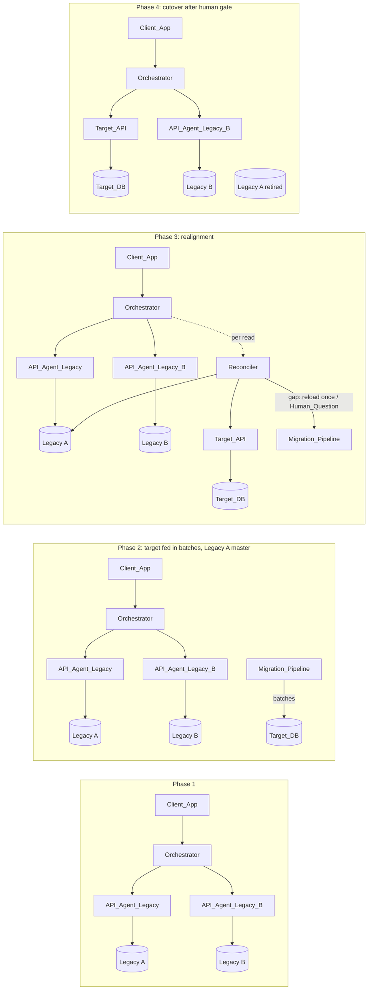
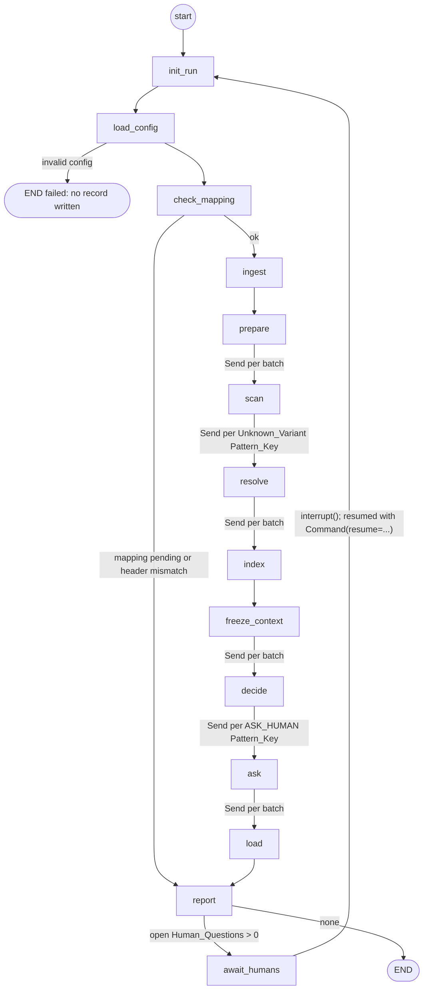
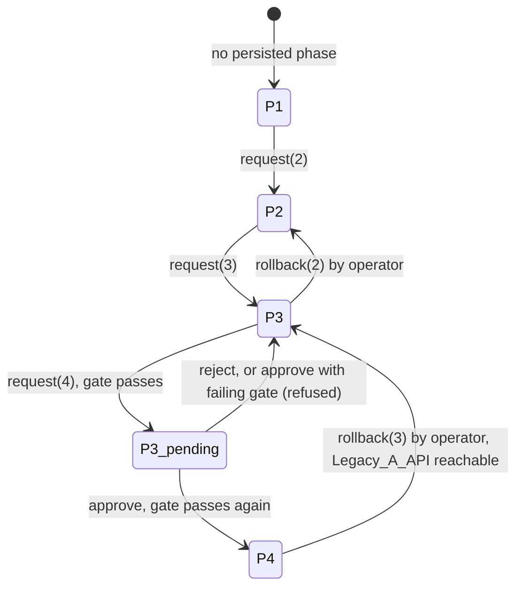

# Design Document: migration-engine

## Overview

The migration-engine migrates the Legacy A CSV to the constrained target model in four Strangler Fig phases. Deterministic rules (`rules/`, pure) decide first. The LLM only sees distinct Unknown_Variant Pattern_Keys, and a human answers one question per Pattern_Key. Every Field_Decision and every row outcome is logged.

Sources of truth: `.kiro/steering/*.md` and the approved `requirements.md`. This document freezes the inter-module contracts (section "Frozen contracts"). Change a contract here first, then in code.

Design scope rules:

- The design depends only on facts in the steering files. The dataset CSV is not in the repository yet. Tests that need it are skipped when `data/legacy/hackathon-2026-digital-continuity-dataset.csv` is absent.
- Optional, do last: Requirement 33 (Query_Agent, bonus chat) and Requirement 34.1 (100,000-row timing).

Research notes that shaped the design:

- LangGraph pauses a graph with `interrupt(payload)` inside a node and resumes with `Command(resume=value)` on the same `thread_id`. Pausing requires a checkpointer; the SQLite one ships in `langgraph-checkpoint-sqlite` (`SqliteSaver`). On resume the interrupted node re-runs from its start, so the node must have no side effect before `interrupt()`. Sources: [LangGraph interrupts](https://docs.langchain.com/oss/python/langgraph/interrupts), [LangChain blog on interrupt](https://www.langchain.com/blog/making-it-easier-to-build-human-in-the-loop-agents-with-interrupt).
- The Anthropic Python SDK (`anthropic.Anthropic(...).messages.create`) returns `usage.input_tokens` and `usage.output_tokens`, accepts a client `timeout` and `max_retries`, and raises typed errors (`APITimeoutError` is a subclass of `APIConnectionError`, itself an `APIError`). Source: [anthropic-sdk-python](https://github.com/anthropics/anthropic-sdk-python).
- SQLAlchemy 1.4+ compiles `regexp_match()` to `REGEXP` on SQLite (backed by a Python function it registers on each pysqlite connection) and to `~` on PostgreSQL. CHECK constraints written with `regexp_match()` therefore stay portable (Requirement 3.7).

Content was rephrased for compliance with licensing restrictions.

## Architecture

### Strangler Fig phases



Routing per phase (Requirements 26, 27, 28):

| Phase | Diagnostics read | Model reference read | Reconciler | Load step of a Run |
|---|---|---|---|---|
| 1 | Legacy_A_API via API_Agent_Legacy | Legacy_B_API via API_Agent_Legacy_B | off | runs (target exists, serves no client read) |
| 2 | Legacy_A_API | Legacy_B_API | off | runs, batches of `batch_size` |
| 3 | Legacy_A_API | Legacy_B_API | on every diagnostics read (background) + Control_Sample on demand | runs |
| 4 | Target_API, zero Legacy_A_API requests | Legacy_B_API | off | runs |

The phase only changes routing. A Run reads the source CSV file directly (Ingestion_Module), so a Run is allowed in every phase.

### Processes, ports and databases

| Process | Module | Command (started manually by the team) | Port |
|---|---|---|---|
| Orchestrator + ops routers (runs, HITL, phase, log, reconciliation, chat) | `agents/orchestrator.py` | `uvicorn agents.orchestrator:app --port 8000` | 8000 |
| Legacy_A_API | `legacy_a/api.py` | `uvicorn legacy_a.api:app --port 8001` | 8001 |
| Legacy_B_API | `legacy_b/api.py` | `uvicorn legacy_b.api:app --port 8002` | 8002 |
| Target_API | `target/api.py` | `uvicorn target.api:app --port 8003` | 8003 |
| UI | `ui/app.py` | `streamlit run ui/app.py` | 8501 |
| Client_App | `client_app/main.py` | `python -m client_app` | n/a |
| Migration CLI (alternative to `POST /ops/campaigns`) | `migration/cli.py` | `python -m migration run` | n/a |

Decision: one FastAPI app per service, one port each. Rejected: one app with routers. Separate processes let the demo stop Legacy A (retirement, Requirement 27.8 refusal, Requirement 26.7 backend-unavailable error) without stopping the orchestrator, and let 7 people work on separate apps. Base URLs are in Rule_Config `services`.

Database files (all under `var/`, git-ignored, SQLite in WAL mode, `PRAGMA foreign_keys=ON` on every connection):

| File | Content | Only writer |
|---|---|---|
| `var/target.db` | Target model tables (Target_DB) | `target/repository.py` |
| `var/ops.db` | run, run_metrics, decision_log, human_question(+_row), human_decision, resolution_cache, llm_call, column_mapping, phase_state, transition_log, reconciliation, run_shared_op_id | owning module per table (see Data Models) |
| `var/checkpoints.db` | LangGraph `SqliteSaver` checkpoints | LangGraph |

Three files: the Target_DB is the "new system" and must be replaceable alone; the Query_Agent opens `target.db` read-only without seeing operational tables; checkpoints can be deleted without touching Human_Decisions (Requirement 21.7); batch loads do not wait on the checkpointer write lock.

### Run_Workflow (LangGraph)



| Node | Unit | Stage (metrics) | Work |
|---|---|---|---|
| `init_run` | control, no row | - | New `run_id` (UUID4), UTC ingestion timestamp, `run` row status `running` (Requirement 4.1) |
| `load_config` | control | ingestion | `load_rule_config()`; invalid -> status `failed`, exit, no Decision_Record (4.3-4.5) |
| `check_mapping` | control | ingestion | Validated Column_Mapping vs header (23.6-23.8) |
| `ingest` | file read as batches | ingestion | `ingest()` -> rows in RunStore, batches of `batch_size` |
| `prepare` | control | rules | Distinct values -> `FieldMemo` (34.2); Legacy_B_Model_Index fetch (11.9-11.11); load Human_Decisions and Resolution_Cache snapshot |
| `scan` | one batch | rules | `scan_row()` on each row: collect Unknown_Variant Pattern_Keys |
| `resolve` | one Pattern_Key | ai_resolution | Cache lookup, Resolver_Agent call or Degraded_Mode marker (24, 25) |
| `index` | one batch | rules | Partial VIN_Model_Index and diagnosticOpID usage |
| `freeze_context` | control | rules | Merge partials, build `shared_op_ids`, persist `run_shared_op_id`, freeze `RuleContext` |
| `decide` | one batch | rules | `decide_row()` on each row |
| `ask` | one Pattern_Key | human_routing | One Human_Question per Pattern_Key (20) |
| `load` | one batch | load | Upsert MIGRATE/CORRECT rows, then write the batch Decision_Records (18, 17) |
| `report` | control | reporting | Report + Run metrics; supersede open questions of earlier Runs |
| `await_humans` | control | - | `interrupt({"run_id", "open_questions"})`, no side effect before it |

Rules of the workflow:

- Fan-out uses `langgraph.types.Send`; the graph runs with `max_concurrency=1`, so batches run in order and SQLite has one writer. An empty fan-out list routes straight to the next stage.
- The checkpoint holds only the small `RunState` (ids, counters, Pattern_Key lists, timings). Rows, the memo and decisions live in the process-local `RunStore` keyed by `run_id`. A crash mid-Run means "start a new Run"; idempotent load makes this safe.
- `thread_id` = `campaign_id`. Resume (`POST /ops/campaigns/{campaign_id}/resume`) sends `Command(resume={"operator": ...})`; `await_humans` returns and the edge goes to `init_run`, which creates a new `run_id` (Requirement 4.8). The new Run reads Human_Decisions from `human_decision`, never from the checkpoint.
- `RuleContext` is built by the pipeline and passed read-only to the Rule_Engine (Requirement 5.2). The Rule_Engine performs no I/O.

```python
# migration/workflow.py
class RunState(TypedDict):
    campaign_id: str
    run_id: str
    kind: Literal["full", "reload"]
    reload_rows: list[int]                       # kind == "reload" only
    status: Literal["running", "failed", "mapping_pending", "completed"]
    n_batches: int
    unknown_keys: Annotated[list[str], add_unique]   # reducer: ordered union
    ask_keys: Annotated[list[str], add_unique]
    stage_seconds: Annotated[dict[str, float], sum_dict]
    counts: Annotated[dict[str, int], sum_dict]      # Row_Outcome counts, OUT_OF_SCOPE
    open_questions: int
    degraded: bool
    legacy_b_status: Literal["enabled", "disabled", "failed"]

def build_run_graph(deps: PipelineDeps, checkpointer: BaseCheckpointSaver) -> CompiledStateGraph: ...
```

## Components and Interfaces

### Module layout

```text
legacy_a/    csv_reader.py, store.py, api.py
legacy_b/    simulator.py, store.py, api.py, data/legacy_b_records.csv, data/legacy_b_conflicts.csv (generated)
target/      schema.py, repository.py, api.py
rules/       types.py, config.py, fields.py, labels.py, opid.py, pattern_key.py, templates.py, memo.py, engine.py
rules/config/ dictionaries.yaml, mappings.yaml, column_mapping.yaml, pipeline.yaml
agents/      llm_client.py, api_agent_legacy.py, api_agent_legacy_b.py, resolver_agent.py, resolution_cache.py, orchestrator.py, query_agent.py (optional)
migration/   ingestion.py, run_store.py, context.py, workflow.py, pipeline.py, phase_controller.py, reconciliation.py, cli.py
hitl/        schemas.py, validation.py, queue.py, store.py
reporting/   schemas.py, decision_log.py, report.py, metrics.py
ui/          app.py, pages/{1_stats,2_questions,3_decision_log,4_phases,5_chat}.py, api_client.py
client_app/  main.py, vins.txt
tests/       unit/, property/, integration/, fixtures/
docs/        architecture.md, cost-performance.md, lessons-learnt.md
```

Dependency direction: `rules` imports nothing project-internal. `legacy_a`, `legacy_b`, `target`, `hitl`, `reporting`, `agents` may import `rules.types` and `rules.config`. `migration` imports all of them. `ui` and `client_app` import nothing but `httpx` and the response schemas.

### Public interfaces

```python
# ---------- rules/types.py (pure, shared by all modules) ----------
Action = Literal["MIGRATE", "TRANSFORM", "CORRECT", "REJECT", "ASK_HUMAN"]
RowOutcome = Literal["MIGRATE", "CORRECT", "REJECT", "ASK_HUMAN"]
DecidedBy = Literal["rule", "llm", "human"]

@dataclass(frozen=True)
class RawRow:
    source_row_id: int                 # 1-based ordinal of the data record in the file
    values: Mapping[str, str]          # canonical column name -> raw cell (exact string)
    malformed: bool = False

@dataclass(frozen=True)
class LLMSuggestion:
    decision: Literal["map", "reject"]; value: str | None; confidence: float; justification: str

@dataclass(frozen=True)
class FieldDecision:
    field: str                          # canonical source column name, "_load" for LOAD
    action: Action
    rule_id: str                        # R1..R8, FC1..FC4, INGEST, LOAD
    reason: str                         # reason code, see "Reason codes"
    before: str                         # raw value as read ("" when the cell is empty)
    after: str = ""                     # "" = no value
    decided_by: DecidedBy = "rule"
    confidence: float | None = None
    explanation: str = ""
    tokens_used: int = 0
    pattern_key: str | None = None      # set when the case needed a Pattern_Key
    suggestion: LLMSuggestion | None = None

@dataclass(frozen=True)
class OperationIdentity:
    vin: str | None; ecu_name: str | None; value_description: str | None
    creation_date: str | None           # ISO "YYYY-MM-DDTHH:MM"
    value_reference: str | None
    def is_complete(self) -> bool: ...

@dataclass(frozen=True)
class TargetValues:
    vin: str; vehicle_model: str; ecu_name: str
    diag_tool_name: str; diag_tool_version: str
    diagnostic_op_id: str; op_id_generated: bool
    creation_date: datetime; value_description: str; value_reference: str
    source_origin_tool: str             # raw originTool, unmodified

@dataclass(frozen=True)
class RowDecision:
    source_row_id: int
    fields: tuple[FieldDecision, ...]   # deterministic evaluation order
    outcome: RowOutcome
    identity: OperationIdentity
    target: TargetValues | None         # set only when outcome in {MIGRATE, CORRECT}

@dataclass(frozen=True)
class HumanDecisionView:
    pattern_key: str; kind: Literal["value", "reject", "generate"]; value: str | None

@dataclass(frozen=True)
class CachedResolution:
    pattern_key: str; decision: Literal["map", "reject"]; value: str | None
    confidence: float; justification: str

@dataclass(frozen=True)
class UnknownVariant:
    pattern_key: str; field: str; normalized_value: str; allowed: AllowedValues

@dataclass(frozen=True)
class RowScan:
    norm_vin: str; matched_model: str | None
    trimmed_op_id: str | None           # None when diagnosticFieId is an Unreadable_Value
    identity: OperationIdentity
    unknown_variants: tuple[UnknownVariant, ...]

@dataclass(frozen=True)
class RuleContext:
    config: "RuleConfig"
    human_decisions: Mapping[str, HumanDecisionView]
    cache: Mapping[str, CachedResolution]
    llm_suggestions: Mapping[str, LLMSuggestion]   # below-threshold / failed proposals of this Run
    llm_status: Mapping[str, Literal["below_threshold", "failed", "degraded"]]
    llm_tokens: Mapping[str, int]                  # keys resolved by a fresh call in this Run -> call tokens
    vin_model_index: Mapping[str, frozenset[str]]
    legacy_b_model_index: Mapping[str, str]
    shared_op_ids: frozenset[str]                  # diagnosticOpID usage: ids carried by >= 2 identities
    degraded: bool
    memo: "FieldMemo | None" = None

# ---------- rules/config.py ----------
class ConfigError(Exception): file: str; error: str
def load_rule_config(config_dir: Path = Path("rules/config")) -> RuleConfig: ...   # raises ConfigError

# ---------- rules/fields.py (field-local, memoized per distinct value) ----------
def normalize_vin(raw: str) -> str: ...
def normalized_key(raw: str) -> str: ...
def dict_lookup(raw: str, dico: Sequence[str]) -> str | None: ...   # canonical entry or None
def is_unreadable(raw: str) -> bool: ...                             # strip()=="" or strip()=="#NOM?"
def r1_vin(raw: str) -> FieldDecision: ...
def r2_tool(raw: str, cfg: RuleConfig) -> R2Result: ...             # mapped | migrate | unreadable | unknown
def r4_classify(raw: str) -> R4Result: ...                           # for ID0002-ID0005
def parse_creation_date(raw: str) -> datetime | None: ...
def format_creation_date(dt: datetime) -> str: ...                   # "dd/mm/yyyy hh:mm"

# ---------- rules/labels.py ----------
def extract_did(label: str) -> str | None: ...                       # r"\(([0-9A-Fa-f]{4})\)\s*$", uppercased
def label_ecu(label: str, ecus: Sequence[str]) -> str | None: ...
def label_template(label: str, ecus: Sequence[str]) -> str: ...

# ---------- rules/opid.py ----------
OP_ID_NAMESPACE: uuid.UUID     # uuid5(NAMESPACE_URL, "urn:legacy-migration:diagnostic-operation")
def canonical_identity(identity: OperationIdentity) -> str: ...
def generate_op_id(identity: OperationIdentity) -> str: ...

# ---------- rules/pattern_key.py ----------
def make_key(field: str, reason: str, detail: str | None = None) -> str: ...
def extend_key(key: str, source_row_id: int) -> str: ...
def parse_key(key: str) -> PatternKeyParts: ...

# ---------- rules/memo.py ----------
@dataclass(frozen=True)
class FieldMemo:
    vin: Mapping[str, str]; tool: Mapping[str, R2Result]; value_ref: Mapping[str, R4Result]
    ecu_name: Mapping[str, str | None]; vehmodel: Mapping[str, str | None]
    label: Mapping[str, LabelFeatures]; date: Mapping[str, datetime | None]
def build_field_memo(distinct: Mapping[str, Iterable[str]], cfg: RuleConfig) -> FieldMemo: ...

# ---------- rules/engine.py ----------
def scan_row(row: RawRow, ctx: RuleContext) -> RowScan: ...
def decide_row(row: RawRow, ctx: RuleContext) -> RowDecision: ...
def row_outcome(decisions: Sequence[FieldDecision]) -> RowOutcome: ...   # ValueError on empty
def final_checks(values: Mapping[str, str], cfg: RuleConfig) -> list[FieldDecision]: ...

# ---------- legacy_a ----------
class SourceReadError(Exception): reason: str                         # open failure, invalid UTF-8
@dataclass(frozen=True)
class SourceFile: header: tuple[str, ...]; rows: tuple[RawRow, ...]; sha256: str
def read_source(path: Path) -> SourceFile: ...                        # legacy_a/csv_reader.py
app: FastAPI                                                          # legacy_a/api.py

# ---------- legacy_b ----------
@dataclass(frozen=True)
class PlantedConflict: vin: str; legacy_a_model: str; legacy_b_modele: str
def to_mixed_case(canonical: str) -> str: ...                         # "MEGANE E-TECH" -> "Megane E-Tech"
def generate(source: SourceFile, cfg: RuleConfig, out_dir: Path) -> tuple[Path, Path]: ...
app: FastAPI                                                          # legacy_b/api.py

# ---------- target ----------
def build_metadata(cfg: RuleConfig) -> MetaData: ...                  # target/schema.py
def make_engine(url: str) -> Engine: ...                              # FK pragma + WAL on connect
@dataclass(frozen=True)
class LoadRow: source_row_id: int; values: TargetValues; run_id: str; ingestion_ts: datetime
@dataclass(frozen=True)
class LoadFailure: source_row_id: int; constraint: str                # name, or FOREIGN KEY|UNIQUE|NOT NULL|CHECK
@dataclass(frozen=True)
class BatchResult: loaded: tuple[int, ...]; failed: tuple[LoadFailure, ...]; retried: bool
class TargetRepository:
    def __init__(self, engine: Engine) -> None: ...
    def load_batch(self, rows: Sequence[LoadRow]) -> BatchResult: ...
    def diagnostics_by_vin(self, vin: str) -> list[DiagnosticItem]: ...
    def table_counts(self) -> dict[str, int]: ...
app: FastAPI                                                          # target/api.py (read only)

# ---------- agents/llm_client.py ----------  (see "LLM_Client contract")
# ---------- agents/api_agent_legacy.py ----------
class LegacyAClient:
    def header(self) -> list[str]: ...
    def rows_page(self, page: int, page_size: int) -> RowsPage: ...
    def rows_by_vin(self, vin: str) -> VinRows: ...
    def is_reachable(self) -> bool: ...
class SchemaDiscoveryAgent:
    def discover(self, run_id: str) -> SchemaProposal: ...
    def validate(self, proposal_id: str, operator: str) -> ColumnMapping: ...   # raises MappingConflictError
    def validated_mapping(self) -> ColumnMapping | None: ...
# ---------- agents/api_agent_legacy_b.py ----------
@dataclass(frozen=True)
class Translation: vin: str | None; vehicle_model: str | None; updated_on: str | None; errors: tuple[FieldError, ...]
def translate(record: LegacyBRecord, cfg: RuleConfig) -> Translation: ...
class ApiAgentLegacyB:
    def model_reference(self, vin: str) -> Translation | None: ...           # None = 404
    def model_index(self, vins: Iterable[str]) -> ModelIndexResult: ...     # index, status ok|failed, errors
# ---------- agents/resolver_agent.py / resolution_cache.py ----------
class ResolverAgent:
    def propose(self, run_id: str, uv: UnknownVariant) -> tuple[LLMSuggestion, int]: ...   # (proposal, tokens)
class ResolutionCache:
    def get_many(self, keys: Iterable[str]) -> dict[str, CachedResolution]: ...
    def put(self, res: CachedResolution, run_id: str, model: str) -> None: ...
# ---------- agents/orchestrator.py ----------
app: FastAPI      # client routes + ops routers (see HTTP routes)

# ---------- migration ----------
@dataclass(frozen=True)
class IngestResult: rows: tuple[RawRow, ...]; header: tuple[str, ...]; sha256: str
class IngestionError(Exception): reason: str; missing_columns: tuple[str, ...]
def ingest(path: Path, mapping: ColumnMapping) -> IngestResult: ...       # migration/ingestion.py
def build_vin_model_index(scans: Iterable[RowScan]) -> dict[str, frozenset[str]]: ...   # context.py
def build_shared_op_ids(scans: Iterable[RowScan]) -> frozenset[str]: ...
class MigrationPipeline:
    def start_campaign(self, operator: str | None = None) -> RunInfo: ...
    def resume(self, campaign_id: str, operator: str) -> RunInfo: ...
    def reload_rows(self, source_row_ids: Sequence[int]) -> RunInfo: ...  # kind="reload"
class PhaseController:
    def current(self) -> int: ...
    def status(self) -> PhaseStatus: ...
    def request(self, target_phase: int, operator: str | None) -> TransitionResult: ...
    def approve(self, operator: str) -> TransitionResult: ...
    def reject(self, operator: str) -> TransitionResult: ...
    def rollback(self, target_phase: int, operator: str) -> TransitionResult: ...
class Reconciler:
    def compare_vin(self, vin: str) -> ReconResult: ...
    def compare_control_sample(self) -> ReconResult: ...
    def control_sample(self) -> list[str]: ...

# ---------- hitl ----------
class HITLQueue:
    def create_questions(self, run_id: str, groups: Mapping[str, QuestionGroup]) -> int: ...
    def open_questions(self, run_id: str | None = None) -> list[HumanQuestion]: ...
    def answer(self, question_id: str, answer: HumanAnswer) -> AnswerResult: ...
    def supersede_before(self, run_id: str) -> int: ...
class HumanDecisionStore:
    def all(self) -> dict[str, HumanDecision]: ...
    def put(self, decision: HumanDecision) -> None: ...          # at most one per Pattern_Key
def validate_value(pattern_key: str, value: str, cfg: RuleConfig, shared: SharedIdView) -> str | None: ...  # failed rule or None

# ---------- reporting ----------
class DecisionLogger:
    def write(self, records: Sequence[DecisionRecord]) -> None: ...      # raises DecisionLogError(run_id, source_row)
    def query(self, run_id: str, filters: LogFilters, limit: int, offset: int) -> DecisionPage: ...
    def export(self, run_id: str, fmt: Literal["json", "csv"], out_dir: Path) -> Path: ...   # UnknownRunError
    @staticmethod
    def import_file(path: Path) -> list[DecisionRecord]: ...
class ReportGenerator:
    def build(self, run_id: str) -> RunReport: ...
    @staticmethod
    def format_text(report: RunReport) -> str: ...
class StageTimer:
    def stage(self, name: str) -> ContextManager[None]: ...
```

### Rule engine design

#### Evaluation order per row

`decide_row` evaluates every step below in this order, so the Field_Decision order is deterministic (Requirement 5.3). A step whose input is undecided (marked "skip") records nothing. A REJECT does not stop later steps, so the log shows every issue of the row and Requirement 30.11 holds for rows rejected for another reason.

| # | Field | Rule | Logic (first matching line wins) |
|---|---|---|---|
| 0 | `_row` | INGEST | `row.malformed` -> REJECT `MALFORMED_ROW`; stop (only decision of the row) |
| 1 | VIN | R1 | `normalize_vin`; not `^[0-9A-Z]{20}$` -> REJECT `INVALID_VIN`; == raw -> MIGRATE `OK`; else CORRECT `NORMALIZED` |
| 2 | originTool | R2 / R8 | Unreadable -> R8 ASK_HUMAN `UNREADABLE`; trimmed in tool_map -> R2 TRANSFORM `MAPPED`; trimmed in ToolDico -> R2 MIGRATE `OK`; else R2 Unknown_Variant path |
| 3 | toolVersion | R8 | Unreadable -> ASK_HUMAN `UNREADABLE`; else MIGRATE `COPIED`, after = raw |
| 4 | Creation_date | R8 | Unreadable -> ASK_HUMAN `UNREADABLE`; parses -> TRANSFORM `DATE_PARSED`, after = ISO `YYYY-MM-DDTHH:MM`; else R8 Unknown_Variant path |
| 5 | ecuCode | R3 | See R3 table |
| 6 | ValueReference | R4 | skip if ValueDescription undecided. ID0001: after = normalized VIN, MIGRATE `VIN_AS_VALUE` if raw == normalized VIN else TRANSFORM `VIN_AS_VALUE`. ID0002-ID0005: `r4_classify` |
| 7 | ecuName | R5 | NK match -> MIGRATE `OK` / CORRECT `DICT_NORMALIZED`; Label_ECU -> CORRECT `LABEL_ECU`; Unreadable -> ASK_HUMAN `UNREADABLE`; else Unknown_Variant path |
| 8 | Vehmodel | R6 / R7 | See R6/R7 table |
| 9 | diagnosticFieId | R8 / R7 | See op-id table |
| 10 | FC fields | FC1-FC4 | Only if no REJECT and no ASK_HUMAN so far: one REJECT `FAILED` per failed check |
| 11 | `_row` | - | `row_outcome()` |

Resolution of an undecided case (any step that produces a Pattern_Key `k`), in order:

1. Human_Decision for `extend_key(k, source_row_id)`, then for `k` (Requirements 5.6, 21.8, A8). `value` -> CORRECT with after = value, `reject` -> REJECT, `generate` -> see op-id table. decided_by `human`, reason `HUMAN_VALUE|HUMAN_REJECT|HUMAN_GENERATE`.
2. For Unknown_Variant keys only: `ctx.cache[k]` -> CORRECT (map) or REJECT (reject), decided_by `llm`, confidence and justification from the cache. If `k` is in `ctx.llm_tokens` (proposal obtained in this Run at or above the threshold, stored in the cache by `resolve`), reason is `LLM_VALUE|LLM_REJECT` and tokens_used is `ctx.llm_tokens[k]`; otherwise reason is `CACHE_VALUE|CACHE_REJECT` and tokens_used is 0 (24.5, 24.7).
3. Otherwise ASK_HUMAN with `pattern_key = k`; `suggestion = ctx.llm_suggestions.get(k)`; explanation states below-threshold, failed or Degraded_Mode from `ctx.llm_status` (20.1, 24.6, 25.3, 25.4).

The value of a target attribute is the `after` of the last Field_Decision of its field with a non-empty `after`.

#### R3 ValueDescription (field `ecuCode`)

`ec = ecuCode.strip()`, `did = extract_did(Label)`, `DID_MAP = {F187: ID0002, F191: ID0003, F188: ID0004, F012: ID0005}`.

| Condition | Action | Reason | Pattern_Key |
|---|---|---|---|
| `ec` in ID0001-ID0005 (Format_1) | MIGRATE, after = `ec`; note if `did` in DID_MAP and DID_MAP[did] != ec | `FORMAT1` | - |
| `ec` matches `^Id[0-9]{3}$`, did in DID_MAP | TRANSFORM, after = DID_MAP[did] | `DID_MAPPED` | - |
| Format_2, did not in DID_MAP | REJECT | `OUT_OF_SCOPE` | - |
| Format_2, no DID | ASK_HUMAN | `FORMAT2_NO_DID` | `ecuCode\|FORMAT2_NO_DID` |
| Unreadable, did in DID_MAP | CORRECT, after = DID_MAP[did] | `DEDUCED_DID` | - |
| Unreadable, did not in DID_MAP | REJECT | `OUT_OF_SCOPE` | - |
| Unreadable, no DID, trimmed Label in `vin_labels` | CORRECT, after = ID0001 | `DEDUCED_VIN_LABEL` | - |
| Unreadable, otherwise | ASK_HUMAN | `UNREADABLE` | `ecuCode\|UNREADABLE\|<Label_Template>` |
| Other non-unreadable value | Unknown_Variant path (rule R3) | `UNKNOWN_VARIANT` | `ecuCode\|UNKNOWN_VARIANT\|<ec>` |

#### R4 classification (`r4_classify`, ID0002-ID0005)

`v = raw.strip().upper()`. First applicable reason wins: `EMPTY` (len 0) > `NOM` (`v == "#NOM?"`) > `EXCEL_SCI` (`^[0-9]+([.,][0-9]+)?E[+-]?[0-9]+$`) > `FORBIDDEN_CHAR` (any char outside `0-9A-Z`) > `WRONG_LENGTH` (len != 10). No reason: MIGRATE `OK` if `v == raw`, else CORRECT `NORMALIZED` with after = `v`.

#### R6 VehicleModel and R7 cardinalities (field `Vehmodel`)

`m = dict_lookup(raw, VehicleModelsDico)`, `idx = ctx.vin_model_index.get(norm_vin, ∅)` (built only from R6 dictionary matches of the Run, Requirement 11.2), `lb = ctx.legacy_b_model_index.get(norm_vin)`.

| Condition | Action / rule | Reason | Pattern_Key |
|---|---|---|---|
| `m` found | MIGRATE or CORRECT, R6 | `OK` / `DICT_NORMALIZED` | - |
| no `m`, `len(idx) == 1` | CORRECT, R6, after = the model | `VIN_SIBLING` | - |
| Unreadable, `len(idx) != 1`, `lb` | CORRECT, R6, after = `lb`, explanation names Legacy B | `LEGACY_B` | - |
| Unreadable, `len(idx) != 1`, no `lb` | ASK_HUMAN, R6 | `UNREADABLE` | `Vehmodel\|UNREADABLE` |
| Unknown_Variant, `len(idx) != 1` | Unknown_Variant path, R6 | `UNKNOWN_VARIANT` | `Vehmodel\|UNKNOWN_VARIANT\|<NK>` |
| then: `len(idx) >= 2` | additional ASK_HUMAN, R7 (every row of the VIN) | `VIN_MULTI_MODEL` | `Vehmodel\|VIN_MULTI_MODEL` |
| then: decided by the `OK`/`DICT_NORMALIZED`/`VIN_SIBLING` lines and `lb` differs | additional ASK_HUMAN, R7 | `LEGACY_B_CONFLICT` | `Vehmodel\|LEGACY_B_CONFLICT` |

A Human_Decision value on a R7 key yields an R7 CORRECT decision whose `after` becomes the VehicleModel.

#### diagnosticOpID (field `diagnosticFieId`)

`t = diagnosticFieId.strip()`. `shared = t in ctx.shared_op_ids`. `ctx.shared_op_ids` = trimmed non-unreadable ids carried by at least two rows of the Run with different `OperationIdentity` tuples (undecided components are `None` and take part in the comparison), computed over all rows of the Run (Requirement 12.2).

| Condition | Action / rule | Reason | Pattern_Key |
|---|---|---|---|
| Unreadable, identity has no ASK_HUMAN component | CORRECT R8, after = `generate_op_id(identity)`, generated flag | `GENERATED_ID` | - |
| Unreadable, identity has an ASK_HUMAN component | skip (no id this Run, 13.4) | - | - |
| not unreadable, not shared | MIGRATE R8, after = raw | `COPIED` | - |
| shared, `generate` Human_Decision, identity complete without ASK_HUMAN | MIGRATE R8 `COPIED`, then CORRECT R7 human, after = UUID v5, generated flag | `HUMAN_GENERATE` | key below |
| shared, `generate` Human_Decision, identity has ASK_HUMAN | MIGRATE R8 `COPIED` only, nothing routed (21.12) | - | - |
| shared, other Human_Decision | MIGRATE R8 `COPIED`, then decision of step 1 with rule R7 | `HUMAN_VALUE` / `HUMAN_REJECT` | key below |
| shared, no Human_Decision | MIGRATE R8 `COPIED`, then ASK_HUMAN R7 | `SHARED_OP_ID` | `diagnosticFieId\|SHARED_OP_ID` |

#### Final checks

Run on final values when the row has no REJECT and no ASK_HUMAN (Requirement 15.1).

| rule_id | Field | Check |
|---|---|---|
| FC1 | VIN | `^[0-9A-Z]{20}$` |
| FC2 | originTool | DiagToolName in {DDT2000, CANalyzer, Clip} |
| FC3 | ecuCode | ValueDescription in {ID0001..ID0005} |
| FC4 | ValueReference | for ID0002-ID0005, `^[0-9A-Z]{10}$` |

A passed check records nothing; the `_row` explanation states "final checks FC1-FC4 passed".

#### Row outcome

`rank = {REJECT: 4, ASK_HUMAN: 3, CORRECT: 2, MIGRATE: 1, TRANSFORM: 1}`; `row_outcome = max rank`, TRANSFORM reported as MIGRATE. The `_row` record carries the outcome, the `rule_id` and `reason` of the first Field_Decision with the winning rank, `decided_by` of that decision, and an explanation counting decisions per Action.

Labelling (Requirement 16.2, 16.3, 16.8): normal mappings are TRANSFORM (R2 map, Format_2 DID, VIN as ID0001 value, date). Anomaly repairs are CORRECT (dictionary normalization that changes the value, deduction of a missing value, LLM/cache/human value). A decision that is both is CORRECT. Everything else is MIGRATE.

#### rule_id and reason codes

| rule_id | Reason codes |
|---|---|
| INGEST | `MALFORMED_ROW` |
| R1 | `OK`, `NORMALIZED`, `INVALID_VIN` |
| R2 | `OK`, `MAPPED`, `UNKNOWN_VARIANT` |
| R3 | `FORMAT1`, `DID_MAPPED`, `OUT_OF_SCOPE`, `FORMAT2_NO_DID`, `DEDUCED_DID`, `DEDUCED_VIN_LABEL`, `UNREADABLE`, `UNKNOWN_VARIANT` |
| R4 | `OK`, `NORMALIZED`, `VIN_AS_VALUE`, `EMPTY`, `NOM`, `EXCEL_SCI`, `FORBIDDEN_CHAR`, `WRONG_LENGTH` |
| R5 | `OK`, `DICT_NORMALIZED`, `LABEL_ECU`, `UNREADABLE`, `UNKNOWN_VARIANT` |
| R6 | `OK`, `DICT_NORMALIZED`, `VIN_SIBLING`, `LEGACY_B`, `UNREADABLE`, `UNKNOWN_VARIANT` |
| R7 | `VIN_MULTI_MODEL`, `SHARED_OP_ID`, `LEGACY_B_CONFLICT` |
| R8 | `UNREADABLE`, `COPIED`, `DATE_PARSED`, `GENERATED_ID`, `UNKNOWN_VARIANT` |
| FC1-FC4 | `FAILED` |
| LOAD | `CONSTRAINT`, `LOAD_FAILED` |
| any (case resolved outside rules) | `HUMAN_VALUE`, `HUMAN_REJECT`, `HUMAN_GENERATE`, `LLM_VALUE`, `LLM_REJECT`, `CACHE_VALUE`, `CACHE_REJECT` |
| `_row` record | `ROW_OUTCOME` |

Unknown_Variant ASK_HUMAN decisions keep reason `UNKNOWN_VARIANT`; the explanation says why (below threshold with confidence, LLM failure type, or Degraded_Mode).

#### Explanation templates (zero tokens)

`rules/templates.py`: `TEMPLATES: dict[tuple[str, str], str]`, rendered with `str.format_map`. Every (rule_id, reason) pair has a template; a unit test checks completeness. Examples:

| (rule_id, reason) | Template |
|---|---|
| (R1, NORMALIZED) | `VIN normalized from '{before}' to '{after}' (trim, uppercase, {removed} disallowed characters removed).` |
| (R1, INVALID_VIN) | `Normalized VIN '{normalized}' has {length} characters; 20 characters [0-9A-Z] are required.` |
| (R2, MAPPED) | `Tool '{before}' mapped to '{after}' (R2 mapping).` |
| (R3, FORMAT1) | `ecuCode {after} used as ValueDescription.{note}` with note ` Label DID {did} maps to {mapped}: inconsistency logged.` |
| (R3, OUT_OF_SCOPE) | `DID {did} is not F187/F191/F188/F012: out of scope.` |
| (R4, EXCEL_SCI) | `ValueReference '{before}' is Excel scientific notation; digits were lost.` |
| (R5, LABEL_ECU) | `ecuName '{before}' not in ECUDico; ECU '{after}' taken from the label.` |
| (R6, LEGACY_B) | `Vehmodel unreadable; model '{after}' taken from Legacy B for VIN {vin}.` |
| (R7, VIN_MULTI_MODEL) | `VIN {vin} has {n} models in this Run ({models}); a vehicle has exactly one model.` |
| (R8, GENERATED_ID) | `diagnosticFieId empty; id {after} generated as UUID v5 over the Operation_Identity.` |
| (LOAD, CONSTRAINT) | `Target DB refused the row: {constraint}.` |
| (*, HUMAN_VALUE) | `Human decision on {pattern_key}: apply value '{after}'.` |

LLM decisions use the justification as explanation (Requirement 17.5).

#### UUID v5 for generated ids

```python
OP_ID_NAMESPACE = uuid.uuid5(uuid.NAMESPACE_URL, "urn:legacy-migration:diagnostic-operation")
def canonical_identity(i: OperationIdentity) -> str:
    return json.dumps([i.vin, i.ecu_name, i.value_description, i.creation_date, i.value_reference],
                      separators=(",", ":"), ensure_ascii=True)
def generate_op_id(i: OperationIdentity) -> str:
    return str(uuid.uuid5(OP_ID_NAMESPACE, canonical_identity(i)))
```

Same identity gives the same id in every Run; JSON array serialization prevents concatenation collisions (Requirement 13.5).

#### Memoization (Requirement 34.2)

`prepare` collects distinct raw values per column (`pandas.Series.unique()` on the batch frame) and calls `build_field_memo` once: R1 per distinct VIN, R2 per originTool, R4 per ValueReference, R5 per ecuName, R6 per Vehmodel, label features per Label, date parse per Creation_date. `scan_row` and `decide_row` read the memo and compute only on a miss (single-row unit tests pass `memo=None`). A test counts calls with a patched counter.

#### Normalization definitions

- `normalize_vin(s) = re.sub(r"[^0-9A-Z]", "", s.strip().upper())`.
- `normalized_key(s)`: remove every character `c` with `c.isspace()` or `c == "-"`, then `.upper()`.
- `dict_lookup(s, dico)`: `{normalized_key(e): e for e in dico}.get(normalized_key(s))`. Dictionary entries have distinct keys (checked at config load).
- `label_template`: `re.sub(r"\w+", lambda w: "<ECU>" if w.group().upper() in ECUDico else w.group(), label).strip()`.
- `label_ecu`: the distinct ECUDico entries among `\w+` tokens of `label.upper()`; exactly one -> that entry.
- `parse_creation_date`: `^([0-9]{2})/([0-9]{2})/([0-9]{4}) ([0-9]{2}):([0-9]{2})$` on the trimmed value, then `datetime(y, m, d, H, M)`; `ValueError` -> invalid (covers 29 February, 24:00, minute 60).

### Legacy B simulator and API_Agent_Legacy_B

`legacy_b/simulator.py::generate(source, cfg, out_dir)`:

1. `vins = sorted({normalize_vin(r.values["VIN"]) for r in source.rows if not r.malformed})`; `rng = random.Random(cfg.legacy_b.seed)`.
2. For each VIN, `models = {dict_lookup(v, VehicleModelsDico)}` over its rows, without `None`. Eligible = exactly one model.
3. `planted = rng.sample(eligible_sorted, cfg.legacy_b.conflicts)` (default 15). For a planted VIN, `MODELE = to_mixed_case(rng.choice(other models))`.
4. Other eligible VINs: `MODELE = to_mixed_case(model)`. Non-eligible VINs: `to_mixed_case(rng.choice(VehicleModelsDico))`.
5. `DATE_MAJ = (date(2020,1,1) + timedelta(days=rng.randrange(2192))).strftime("%Y%m%d")`.
6. `to_mixed_case`: split on spaces and dashes keeping separators, capitalize each part (`"SCENIC E-TECH"` -> `"Scenic E-Tech"`).

Files (UTF-8, `;`, LF, header row):

| File | Columns |
|---|---|
| `legacy_b/data/legacy_b_records.csv` | `CHASSIS_NO;MODELE;DATE_MAJ` |
| `legacy_b/data/legacy_b_conflicts.csv` (Legacy_B_Control_File) | `VIN;LEGACY_A_MODEL;LEGACY_B_MODELE` (VIN, canonical Legacy A model, planted raw `MODELE`) |

Same source file and seed give byte-identical files (Requirement 30.6).

`translate(record, cfg)`: VIN = `normalize_vin(CHASSIS_NO)` (error if not 20 chars), VehicleModel = `dict_lookup(MODELE, VehicleModelsDico)` (error if none), `updated_on` = `datetime.strptime(DATE_MAJ, "%Y%m%d").date().isoformat()` after checking `^[0-9]{8}$` (error otherwise). Each untranslatable field is omitted and gets a `FieldError(field, raw)` (Requirement 30.10).

`model_index(vins)`: bulk GET in chunks of 200 VINs; 404/missing VIN = result without entry; any transport error or 5xx -> `status="failed"` and the pipeline uses an empty index (Requirement 11.11).

### Phase controller, orchestrator routing, reconciliation



- `P3_pending` keeps `current_phase = 3` with `pending_target = 4` (Requirement 29.4).
- Gate checks (Requirement 29.1): (a) `open_questions`: count of `human_question.status = 'open'` (superseded and closed do not count; per-row questions count one by one); (b) `control_sample_gaps`: gaps of the latest `reconciliation` row with `scope = 'control_sample'`, failed with message "no reconciliation available" when none.
- Every refusal (skip, back by more than one, back to 1, rollback without operator, same phase, outside 1-4, Legacy A unreachable on 4 -> 3) keeps the phase, writes no `transition_log` row, and returns the reason (Requirement 27.3, 27.8).
- A switch writes `phase_state` and `transition_log` in one ops.db transaction, then swaps the in-memory phase under a lock. Persistence failure keeps the old phase (Requirement 27.6).
- Orchestrator: each request reads `phase_controller.current()` once at its start and finishes on that backend (Requirement 26.5). A backend error returns 503 `BACKEND_UNAVAILABLE`, no fallback (Requirement 26.7).

Reconciler (phase 3):

- Expected records for a VIN: Legacy A rows from `LegacyAClient.rows_by_vin`, decided by `decide_row` with a context made of current Rule_Config, Human_Decisions, cache, a VIN_Model_Index built from those rows (exact, the index is per VIN), the Legacy B model of the VIN when the lookup is enabled, and `shared_op_ids` read from `run_shared_op_id` of the latest full Run. Kept: outcome MIGRATE or CORRECT.
- Match on `OperationIdentity` against `GET /target/vehicles/{vin}/diagnostics`. Gap = no match, or a difference on `diagnostic_op_id`, `vehicle_model`, `diag_tool_name`, `diag_tool_version`.
- Each gap triggers one `MigrationPipeline.reload_rows([source_row_id])` (a Run of kind `reload`: full context, load and log only the listed rows, no Human_Question), then one re-compare. Remaining gap -> Human_Question `_row|RECON_GAP|<source_row_id>` unless one exists (Requirement 28.4). Options: `apply_value` with the only allowed value `ACCEPT_TARGET` (count as aligned), `reject_group` (exclude from expected records).
- Read failure for a VIN -> `not_performed` for that VIN, excluded from counts (Requirement 28.7).
- `Aligned_Percentage = round(100 * aligned / compared, 1)`, `None` ("not applicable") when `compared == 0`.
- Control_Sample: `random.Random(cfg.control_sample.seed).sample(sorted(distinct normalized VINs of Legacy A), min(size, n))`, default size 50.
- Per-read comparison runs as a FastAPI background task, so client latency does not include it.

### Frozen contracts

#### 1. HTTP routes

Common error body for every service: `ErrorResponse{error: {code, message, details}}`, `code` in `NOT_FOUND | BACKEND_UNAVAILABLE | VALIDATION_ERROR | CONFLICT | UNKNOWN_RUN | REFUSED | INTERNAL`. FastAPI parameter validation errors (422) keep the FastAPI `detail` format, which names the invalid parameter (Requirement 2.4). Undefined methods on a defined path return 405 (FastAPI default).

Legacy_A_API (`:8001`, GET only):

| Route | Query / path | Response 200 |
|---|---|---|
| `GET /legacy-a/rows` | `page: int >= 1 = 1`, `page_size: int 1..1000 = 100` | `RowsPage` (empty `rows` past the last page) |
| `GET /legacy-a/vehicles/{vin}/rows` | `vin`: any string, R1-normalized before match | `VinRows` (empty `rows` when no match) |
| `GET /legacy-a/header` | - | `Header` |
| `GET /legacy-a/health` | - | `{"status": "ok"}` |

Legacy_B_API (`:8002`, GET only, native format):

| Route | Response |
|---|---|
| `GET /legacy-b/vehicles/{chassis_no}` | 200 `LegacyBRecord`; 404 `ErrorResponse` NOT_FOUND (no record in body) |
| `GET /legacy-b/vehicles?chassis_no=A&chassis_no=B` (1..200 values) | 200 `LegacyBBulk` |
| `GET /legacy-b/health` | `{"status": "ok"}` |

Target_API (`:8003`, GET only, read-only connection):

| Route | Response |
|---|---|
| `GET /target/vehicles/{vin}/diagnostics` | 200 `DiagnosticsResponse`; 404 NOT_FOUND when no operation |
| `GET /target/stats` | `{"tables": {name: count}}` |
| `GET /target/health` | `{"status": "ok"}` |

Orchestrator (`:8000`), client routes (the only routes the Client_App uses):

| Route | Response |
|---|---|
| `GET /api/vehicles/{vin}/diagnostics` | 200 `DiagnosticsResponse`; 404 NOT_FOUND; 503 BACKEND_UNAVAILABLE |
| `GET /api/vehicles/{vin}/model` | 200 `ModelReference`; 404 NOT_FOUND; 503 BACKEND_UNAVAILABLE |

Phases 1-3 build `DiagnosticsResponse` from raw Legacy A rows through the validated Column_Mapping (raw strings, VIN R1-normalized, rows in Source_Row_Id order). Phase 4 returns Target_DB values. The schema is the same; the body never names the backend.

Orchestrator ops routes (used by the UI):

| Route | Body / query | Response |
|---|---|---|
| `POST /ops/campaigns` | `StartRunRequest` | 202 `RunInfo` (first Run) |
| `POST /ops/campaigns/{campaign_id}/resume` | `{operator}` | 202 `RunInfo` (new run_id); 409 if campaign not paused |
| `GET /ops/runs` | `limit`, `offset` | `list[RunInfo]` |
| `GET /ops/runs/{run_id}` | - | `RunInfo`; 404 UNKNOWN_RUN |
| `GET /ops/runs/{run_id}/report` | - | `RunReport` |
| `GET /ops/runs/{run_id}/metrics` | - | `RunMetrics` |
| `GET /ops/runs/{run_id}/decisions` | `source_row, field, action, rule_id, decided_by, limit<=1000, offset` | `DecisionPage` |
| `GET /ops/runs/{run_id}/decisions/export` | `format=json\|csv` | file (`application/json` / `text/csv; charset=utf-8`); 404 UNKNOWN_RUN |
| `GET /ops/questions` | `status=open\|closed\|superseded`, `run_id` | `list[HumanQuestion]` |
| `GET /ops/questions/{question_id}` | - | `HumanQuestion` |
| `POST /ops/questions/{question_id}/answer` | `HumanAnswer` | 200 `AnswerResult`; 409 CONFLICT (closed, option not allowed); 422 VALIDATION_ERROR (value, names the failed rule) |
| `POST /ops/schema/discover` | - | `SchemaProposal` |
| `POST /ops/schema/validate` | `{proposal_id, operator}` | `ColumnMapping`; 409 CONFLICT with conflicts |
| `GET /ops/schema/mapping` | - | `ColumnMapping`; 404 when none |
| `GET /ops/phase` | - | `PhaseStatus` |
| `POST /ops/phase/transition` | `TransitionRequest` | `TransitionResult` (always 200; `status` tells the result) |
| `POST /ops/phase/approve` | `{operator}` | `TransitionResult` |
| `POST /ops/phase/reject` | `{operator}` | `TransitionResult` |
| `POST /ops/phase/rollback` | `RollbackRequest` | `TransitionResult` |
| `GET /ops/phase/transitions` | - | `list[TransitionLogEntry]` |
| `POST /ops/reconciliation/control-sample` | - | `ReconResult` |
| `GET /ops/reconciliation/latest` | `scope=vin\|control_sample` | `ReconResult`; 404 when none |
| `POST /ops/chat` (optional, Requirement 33) | `ChatRequest` | `ChatResponse` |

```python
# reporting/schemas.py, hitl/schemas.py, agents/schemas.py (pydantic v2)
class RawRowOut(BaseModel): source_row_id: int; values: dict[str, str]; malformed: bool = False
class RowsPage(BaseModel): page: int; page_size: int; total_rows: int; rows: list[RawRowOut]
class VinRows(BaseModel): vin: str; rows: list[RawRowOut]
class Header(BaseModel): columns: list[str]
class LegacyBRecord(BaseModel): CHASSIS_NO: str; MODELE: str; DATE_MAJ: str
class LegacyBBulk(BaseModel): records: list[LegacyBRecord]; missing: list[str]
class DiagnosticItem(BaseModel):
    diagnostic_op_id: str | None; creation_date: str | None; ecu_name: str | None
    value_description: str | None; value_reference: str | None
    diag_tool_name: str | None; diag_tool_version: str | None; vehicle_model: str | None
class DiagnosticsResponse(BaseModel): vin: str; operations: list[DiagnosticItem]
class FieldError(BaseModel): field: str; raw: str
class ModelReference(BaseModel):
    vin: str | None; vehicle_model: str | None; updated_on: str | None; errors: list[FieldError] = []
class StartRunRequest(BaseModel): operator: str | None = None
class RunInfo(BaseModel):
    run_id: str; campaign_id: str; kind: Literal["full", "reload"]
    status: Literal["running", "completed", "failed", "mapping_pending"]
    campaign_status: Literal["running", "paused", "done"]
    started_at: datetime; ended_at: datetime | None; open_questions: int
class RunReport(BaseModel):
    run_id: str; text: str; analysed: int; migrate: int; correct: int; reject: int; ask_human: int
    out_of_scope: int; traced_pct: float; tokens: int; cost_eur: float; seconds: float; notes: list[str]
class RunMetrics(BaseModel):
    run_id: str; total_seconds: float; stage_seconds: dict[str, float]   # ingestion, rules, ai_resolution, human_routing, load, reporting
    input_tokens: int; output_tokens: int; llm_calls: int; distinct_pattern_keys: int
    cache_hit_rate: float; batch_size: int; out_of_scope_rejects: int
    degraded_mode: bool; legacy_b_lookup: Literal["enabled", "disabled", "failed"]
    counts: dict[RowOutcome, int]
class LogFilters(BaseModel):
    source_row: int | None = None; field: str | None = None; action: Action | None = None
    rule_id: str | None = None; decided_by: DecidedBy | None = None
class DecisionPage(BaseModel): total: int; items: list[DecisionRecord]
class TransitionRequest(BaseModel): target_phase: int; operator: str | None = None
class RollbackRequest(BaseModel): target_phase: int; operator: str = Field(min_length=1)
class GateCheck(BaseModel):
    name: Literal["open_questions", "control_sample_gaps"]; passed: bool; count: int | None; message: str
class TransitionResult(BaseModel):
    status: Literal["switched", "pending_approval", "refused", "cancelled"]
    current_phase: int; previous_phase: int | None; reason: str | None; checks: list[GateCheck] = []
class PhaseStatus(BaseModel):
    current_phase: int; pending_target: int | None; gate: list[GateCheck]; served: dict[str, int]
class TransitionLogEntry(BaseModel):
    from_phase: int; to_phase: int; rollback: bool; operator: str | None; at: datetime
class ReconResult(BaseModel):
    scope: Literal["vin", "control_sample"]; compared: int; gaps: int
    aligned_pct: float | None; not_performed: list[str]; at: datetime
class ChatRequest(BaseModel): question: str
class ChatResponse(BaseModel):
    sql: str | None; rows: list[dict[str, Any]]; truncated: bool
    input_tokens: int; output_tokens: int; error: ErrorBody | None = None
```

#### 2. Decision_Record

```python
class DecisionRecord(BaseModel):            # reporting/schemas.py
    run_id: str
    source_row: int                         # Source_Row_Id
    field: str                              # canonical column name | "_row" | "_load"
    action: Action                          # "_row": the Row_Outcome
    rule_id: str                            # R1..R8 | FC1..FC4 | INGEST | LOAD
    reason: str                             # reason code (never empty)
    before: str                             # raw value exactly as read; "" for "_row"
    after: str                              # "" = no value
    decided_by: DecidedBy
    confidence: float | None                # only for decided_by == "llm"
    explanation: str                        # non-empty
    tokens_used: int                        # call tokens for a fresh LLM decision, else 0
    timestamp: datetime                     # UTC, serialized "YYYY-MM-DDTHH:MM:SS.ffffffZ"
```

- One record per Field_Decision plus exactly one `_row` record per source row per Run (Requirement 17.1, 17.2).
- `tokens_used` repeats the tokens of the call on every record of the Pattern_Key. Run totals come from `LLMClient.totals(run_id)`, never from summing records.
- Human decisions: explanation `Human decision on {pattern_key}: {option}[ '{value}']` (Requirement 17.6).
- JSON export: `decision_log_<run_id>.json`, a UTF-8 JSON array (`ensure_ascii=False`) of objects with the field order above.
- CSV export: `decision_log_<run_id>.csv`, UTF-8 without BOM, `,` separator, RFC 4180 quoting (`csv.QUOTE_MINIMAL`, `newline=""`), header = field names in the order above. `confidence` empty cell <-> `None`; all other columns are non-null strings or integers, so the round trip is exact (Requirement 17.9).

#### 3. Human_Question, Human_Decision and Pattern_Key

Pattern_Key format: `<field>|<reason>[|<detail>][#row=<source_row_id>]`. `detail` is percent-encoded for `%`, `|` and `#` (`%25`, `%7C`, `%23`).

| Case | Pattern_Key | Allowed values for `apply_value` |
|---|---|---|
| R3 Format_2 without DID (8.5) | `ecuCode\|FORMAT2_NO_DID` | ID0001-ID0005 |
| R3 unreadable ecuCode, no deduction (8.9) | `ecuCode\|UNREADABLE\|<Label_Template>` | ID0001-ID0005 |
| R5 unreadable, no Label_ECU (10.5) | `ecuName\|UNREADABLE` | ECUDico |
| R6 unreadable, no other source (11.7) | `Vehmodel\|UNREADABLE` | VehicleModelsDico |
| R7 VIN with two models (12.1) | `Vehmodel\|VIN_MULTI_MODEL` | VehicleModelsDico |
| R7 Legacy B conflict (12.5) | `Vehmodel\|LEGACY_B_CONFLICT` | VehicleModelsDico |
| R7 shared diagnosticOpID (12.2) | `diagnosticFieId\|SHARED_OP_ID` | non-empty trimmed id <= 128 chars, not in `run_shared_op_id` of the latest full Run and not carried by rows with different identities; plus `generate_op_id` option |
| R8 unreadable (13.1) | `originTool\|UNREADABLE`, `toolVersion\|UNREADABLE`, `Creation_date\|UNREADABLE` | ToolDico; non-empty <= 64 printable chars; valid `dd/mm/yyyy hh:mm` |
| Unknown_Variant (24.10) | `<field>\|UNKNOWN_VARIANT\|<Normalized_Key or trimmed value>` | the field's allowed values (ToolDico, ID0001-ID0005, ECUDico, VehicleModelsDico, valid date) |
| Case by case (21.5) | `<group key>#row=<source_row_id>` | same as the group |
| Reconciliation gap (28.4) | `_row\|RECON_GAP\|<source_row_id>` | `ACCEPT_TARGET` |

```python
# hitl/schemas.py
Option = Literal["apply_value", "reject_group", "case_by_case", "generate_op_id"]
class ExampleRow(BaseModel): source_row_id: int; values: dict[str, str]
class HumanQuestion(BaseModel):
    question_id: str                      # UUID4
    run_id: str | None                    # None for reconciliation gaps
    pattern_key: str; field: str; reason: str; rule_id: str
    row_count: int                        # distinct Source_Row_Ids in the group
    example_rows: list[ExampleRow]        # first min(row_count, hitl_example_rows) in source order
    missing: str                          # what is missing, from a template
    why: str                              # why no rule/agent decided, from a template
    llm_suggestion: LLMSuggestion | None
    llm_status: Literal["proposed_below_threshold", "failed", "degraded", "not_applicable"]
    allowed_values: list[str] | None      # None = free value validated by a pattern
    options: list[Option]                 # apply_value, reject_group, case_by_case on group keys;
                                          # + generate_op_id only for diagnosticFieId|SHARED_OP_ID;
                                          # no case_by_case on "#row=" keys
    status: Literal["open", "closed", "superseded"]
    parent_question_id: str | None
    created_at: datetime; closed_at: datetime | None
class HumanAnswer(BaseModel): option: Option; value: str | None = None; operator: str = Field(min_length=1)
class HumanDecision(BaseModel):
    pattern_key: str; kind: Literal["value", "reject", "generate"]; value: str | None
    answered_at: datetime; operator: str; question_id: str
class AnswerResult(BaseModel):
    question: HumanQuestion; decision: HumanDecision | None; created_questions: list[str] = []
```

Answer rules: `apply_value` validates first (`validate_value`), stores a `value` decision, closes the question. `reject_group` stores `reject`. `generate_op_id` (SHARED_OP_ID key only) stores `generate`. `case_by_case` closes the group question without a decision and creates one question per member row (`#row=` key, `parent_question_id` set). Answers to closed or superseded questions, `case_by_case` on a `#row=` key, and `generate_op_id` elsewhere are refused with 409 and change nothing (Requirement 21.6). `report` of a full Run marks open questions of earlier full Runs `superseded`; gap questions are never superseded.

#### 4. LLM_Client contract and prompts

```python
# agents/llm_client.py
LLMErrorType = Literal["missing_key", "timeout", "provider_error"]
Purpose = Literal["schema_discovery", "resolver", "question_rephrase", "query_agent"]

@dataclass(frozen=True)
class LLMSuccess:
    text: str; input_tokens: int; output_tokens: int; model: str; latency_ms: int
    ok: Literal[True] = True
@dataclass(frozen=True)
class LLMFailure:
    error_type: LLMErrorType; message: str          # message never contains the key
    input_tokens: int = 0; output_tokens: int = 0
    ok: Literal[False] = False
LLMResult = LLMSuccess | LLMFailure

@dataclass(frozen=True)
class RunTokenTotals: input_tokens: int; output_tokens: int; calls: int

class LLMClient:
    def __init__(self, cfg: LLMConfig, engine: Engine) -> None: ...   # writes llm_call rows in ops.db
    def is_available(self) -> bool: ...                                 # ANTHROPIC_API_KEY set and non-empty
    def complete(self, *, run_id: str, purpose: Purpose, system: str, prompt: str,
                 max_tokens: int | None = None) -> LLMResult: ...      # never raises
    def totals(self, run_id: str) -> RunTokenTotals: ...                # zeros for unknown run_id
```

- Key read from `os.environ["ANTHROPIC_API_KEY"]` at each `complete` call; unset or empty -> `LLMFailure("missing_key")`, no provider contact, call count unchanged (Requirement 22.6).
- Provider: `anthropic.Anthropic(api_key=key, timeout=cfg.timeout_s, max_retries=0).messages.create(model=cfg.model, max_tokens=..., system=system, messages=[{"role": "user", "content": prompt}])`.
- `APITimeoutError` -> `timeout`; any other `anthropic.APIError` -> `provider_error`. Message = exception class name + HTTP status only.
- Every provider call, success or failure, increments the run call count and adds reported tokens (0 when absent) (Requirement 22.3).

Resolver_Agent prompt (one call per Pattern_Key, Requirement 24.2):

```text
system: You normalize one legacy data value for a vehicle-diagnostics migration.
Reply with one JSON object only: {"decision":"map"|"reject","value":string|null,"confidence":number,"justification":string}.
"value" must be one of "allowed" (or match "allowed_format"). Confidence is between 0 and 1.
user:   {"field":"ecuName","reason":"UNKNOWN_VARIANT","value":"BCMX","allowed":["BCM","AIRBAG","TCM","BMS","OBC","ECM","ABS","ADAS","HVAC","IVI","VCU","EPS"]}
        (for Creation_date: "allowed_format":"dd/mm/yyyy hh:mm" instead of "allowed")
```

Parsing: first `{...}` block of the text, validated by a pydantic model. Invalid JSON, missing key, confidence outside [0, 1], empty justification or value outside the allowed set -> confidence 0, justification = failure reason (Requirement 24.4). `max_tokens` 150.

API_Agent_Legacy schema discovery prompt (Requirement 23.1):

```text
system: You map the columns of a CSV export to a target data model. Reply with JSON only.
user:   header: <header line>
        sample (first N rows, ';'-separated): <rows>
        target attributes: Vehicle.VIN, Vehicle.VehicleModel, DiagnozedECU.ecuName,
          DiagnosticOperation.diagnosticOpID, DiagnosticOperation.creationDate,
          DiagValueResult.ValueReference, DiagValueResult.ValueDescription,
          DiagToolsVersions.DiagToolName, DiagToolsVersions.DiagToolVersion, Label
        The ecuCode column mixes two record formats; describe the criterion.
response: {"column_mapping": {"<header column>": "<target attribute>"|null, ...},
           "formats": [{"name": "Format_1", "ecuCode_pattern": "^ID000[1-5]$"},
                       {"name": "Format_2", "ecuCode_pattern": "^Id[0-9]{3}$"}],
           "format_criterion": "<text>"}
```

```python
class FormatSpec(BaseModel): name: Literal["Format_1", "Format_2"]; ecuCode_pattern: str
class MappingConflict(BaseModel): target_attribute: str; source_columns: list[str]
class SchemaProposal(BaseModel):
    proposal_id: str; column_mapping: dict[str, str | None]; formats: list[FormatSpec]
    format_criterion: str; conflicts: list[MappingConflict]; fallback: bool; created_at: datetime
class ColumnMapping(BaseModel):
    mapping: dict[str, str | None]; validated_by: str; validated_at: datetime
    def source_for(self, target_attribute: str) -> str: ...
```

A conflict is a required target attribute (list in `column_mapping.yaml`) mapped by zero or by two or more source columns. Ingestion renames source columns to canonical names (the reference column names of `migration-rules.md`) through the validated mapping, so the Rule_Engine and the Decision_Records always use canonical names.

## Data Models

### Rule_Config (`rules/config/*.yaml`, pydantic-validated)

| File | Content |
|---|---|
| `dictionaries.yaml` | `vehicle_models`, `ecus`, `tools`, `value_descriptions` (code -> description) |
| `mappings.yaml` | `tool_map` (DiagTool -> DDT2000, AfterSalesDiag -> Clip), `did_map`, `vin_labels` (4 labels) |
| `column_mapping.yaml` | reference Column_Mapping, `required_targets` |
| `pipeline.yaml` | tunables below |

```python
class LLMConfig(BaseModel):
    model: str = "claude-haiku-4-5"; timeout_s: float = Field(20, gt=0); max_tokens: int = 150
    price_eur_per_input_token: float = Field(ge=0); price_eur_per_output_token: float = Field(ge=0)
class PipelineConfig(BaseModel):
    confidence_threshold: float = Field(0.9, ge=0.0, le=1.0)
    batch_size: int = Field(1000, ge=1)
    legacy_b_lookup: bool = True
    hitl_example_rows: int = Field(5, ge=1)
    discovery_sample_size: int = Field(20, ge=1)
    llm: LLMConfig
    control_sample: ControlSampleConfig        # size: int = 50, seed: int = 42
    legacy_b: LegacyBSimConfig                 # seed: int = 2026, conflicts: int = 15
    services: ServicesConfig                   # base URLs of the four APIs
    client_app: ClientAppConfig                # interval_s 0.1..60 = 1.0, timeout_s = 5.0
    query_agent: QueryAgentConfig              # enabled False, row_limit 1..1000 = 200, allowed_tables
class RuleConfig(BaseModel):
    dictionaries: Dictionaries; mappings: Mappings; column_mapping: ReferenceMapping; pipeline: PipelineConfig
    config_hash: str                           # sha256 of the four files, stored on the run row
```

A missing file, invalid YAML or a schema error raises `ConfigError(file, error)`; the pipeline exits with a failure status before any row and writes nothing (Requirement 4.5).

### Target_DB (`var/target.db`, `target/schema.py`)

Portable types only: `String(n)`, `Integer`, `Boolean`, `DateTime`. Regex CHECKs use `regexp_match()`. Dictionary CHECKs are built from Rule_Config at `create_all` (a dictionary change requires recreating the schema).

| Table | Columns | Constraints |
|---|---|---|
| `vehicle` | `vin String(20)`, `vehicle_model String(32) NOT NULL` | `pk_vehicle (vin)`, `ck_vehicle_vin_format: vin ~ ^[0-9A-Z]{20}$`, `ck_vehicle_model_dico: vehicle_model IN (VehicleModelsDico)` |
| `diagnozed_ecu` | `ecu_name String(16)` | `pk_diagnozed_ecu`, `ck_ecu_name_dico: ecu_name IN (ECUDico)` |
| `vehicle_ecu` | `vin`, `ecu_name` | `pk_vehicle_ecu (vin, ecu_name)`, `fk_vehicle_ecu_vehicle -> vehicle.vin`, `fk_vehicle_ecu_ecu -> diagnozed_ecu.ecu_name` |
| `diag_tools_versions` | `diag_tool_name String(16)`, `diag_tool_version String(64)` | `pk_diag_tools_versions (name, version)`, `ck_tool_name_dico: diag_tool_name IN (ToolDico)` |
| `diagnostic_operation` | `diagnostic_op_id String(128)`, `creation_date DateTime NOT NULL`, `vin`, `ecu_name`, `diag_tool_name`, `diag_tool_version`, `source_origin_tool String(128) NOT NULL`, `ingestion_ts DateTime NOT NULL`, `run_id String(36) NOT NULL`, `source_row_id Integer NOT NULL`, `op_id_generated Boolean NOT NULL` | `pk_diagnostic_operation`, `fk_operation_vehicle_ecu (vin, ecu_name) -> vehicle_ecu`, `fk_operation_tool_version (name, version) -> diag_tools_versions` |
| `diag_value_result` | `diagnostic_op_id`, `value_reference String(32) NOT NULL`, `value_description String(6) NOT NULL` | `pk_diag_value_result (diagnostic_op_id)` (1-1), `fk_value_result_operation`, `ck_value_description_dico: IN (ID0001..ID0005)`, `ck_value_reference_format: value_description = 'ID0001' OR value_reference ~ ^[0-9A-Z]{10}$` |

All key columns are `NOT NULL`. Upsert (`INSERT ... ON CONFLICT DO UPDATE`, via `sqlalchemy.dialects.sqlite.insert`; the PostgreSQL dialect has the same construct) in dependency order: vehicle, diagnozed_ecu, vehicle_ecu, diag_tools_versions, diagnostic_operation, diag_value_result. Nothing is ever deleted (Requirement 18.7). Constraint name extraction from `sqlite3.IntegrityError`: `CHECK constraint failed: <name>` -> name; `UNIQUE|NOT NULL constraint failed: <t.c>` -> type plus columns; `FOREIGN KEY constraint failed` -> `FOREIGN KEY`.

Load algorithm (`TargetRepository.load_batch`): one transaction per batch; on any error, roll back, then one transaction per row; a row that fails again is returned in `failed` and becomes REJECT `LOAD` (Requirements 3.8, 3.9, 18.3-18.5).

### Operational tables (`var/ops.db`)

| Table | Key columns | Writer |
|---|---|---|
| `run` | `run_id PK`, `campaign_id`, `kind`, `status`, `started_at`, `ended_at`, `ingestion_ts`, `source_sha256`, `config_hash`, `phase_at_start` | migration |
| `run_metrics` | `run_id PK`, fields of `RunMetrics` (`stage_seconds` as JSON text) | reporting |
| `decision_log` | `id PK`, fields of `DecisionRecord`; `ck_decision_action`, `ck_decision_decided_by`; indexes `(run_id, source_row)`, `(run_id, action)`, `(run_id, rule_id)` | reporting (Decision_Logger) |
| `human_question` | `question_id PK`, fields of `HumanQuestion` (JSON text for lists), `uq_question_run_key (run_id, pattern_key)` | hitl |
| `human_question_row` | `(question_id, source_row_id) PK` | hitl |
| `human_decision` | `pattern_key PK`, `kind`, `value`, `answered_at`, `operator`, `question_id` | hitl (Human_Decision_Store) |
| `resolution_cache` | `pattern_key PK`, `field`, `normalized_value`, `decision`, `value`, `confidence`, `justification`, `model`, `created_run_id`, `created_at` | agents/resolution_cache |
| `llm_call` | `id PK`, `run_id`, `purpose`, `status`, `error_type`, `input_tokens`, `output_tokens`, `latency_ms`, `at` | agents/llm_client |
| `column_mapping` | `id PK`, `status (proposed\|validated)`, `mapping JSON`, `formats JSON`, `conflicts JSON`, `fallback`, `created_at`, `validated_by`, `validated_at` (one `validated` row, replaced on validation) | agents/api_agent_legacy |
| `phase_state` | `id PK CHECK (id = 1)`, `current_phase CHECK 1..4`, `pending_target`, `updated_at` | migration/phase_controller |
| `transition_log` | `id PK`, `from_phase`, `to_phase`, `rollback`, `operator`, `at` | migration/phase_controller |
| `reconciliation` | `id PK`, `scope`, `vin`, `compared`, `gaps`, `aligned_pct`, `not_performed JSON`, `at` | migration/reconciliation |
| `run_shared_op_id` | `(run_id, op_id) PK` | migration |

### End-of-run report

`ReportGenerator.format_text` reproduces the `product.md` block: thousands separator `,`, the separator line copied from `product.md`, `{traced}% decisions traced` (one decimal, `.0` dropped), `Estimated AI consumption: {tokens:,} tokens (≈ {cost:.4f} €)`, `Processing time: {m} min {s} sec`. Extra `notes` lines follow the block (Column_Mapping pending, header mismatch with added and missing names, Degraded_Mode, Legacy B lookup failed). Counts come from the Run's `_row` records; the metrics row is written from the same in-memory values (Requirement 19.6).

## Correctness Properties

*A property is a characteristic or behavior that should hold true across all valid executions of a system-essentially, a formal statement about what the system should do. Properties serve as the bridge between human-readable specifications and machine-verifiable correctness guarantees.*

Scope is fixed by Requirement 5.8: hypothesis properties exist only for R1, R4, Normalized_Key and dictionary lookup, Row_Outcome classification and load idempotence. Every other multi-value criterion uses example-based tests (Requirement 5.9).

### Property 1: R1 VIN normalization and classification

*For any* string `s`, `v = normalize_vin(s)` contains only characters of `[0-9A-Z]`, `normalize_vin(v) == v`, and `r1_vin(s)` returns REJECT with an explanation containing `v` and `len(v)` when `v` does not match `^[0-9A-Z]{20}$`, MIGRATE with `before == after == s` when `v` matches and `v == s`, and CORRECT with `before == s` and `after == v` otherwise.

**Validates: Requirements 6.1, 6.3, 6.4, 6.5, 6.6**

### Property 2: R4 ValueReference classification

*For any* string `s` with ValueDescription in ID0002-ID0005, let `v = s.strip().upper()`. `r4_classify(s)` returns MIGRATE with `after == s` (when `v == s`) or CORRECT with `after == v` (when `v != s`) exactly when `v` matches `^[0-9A-Z]{10}$`; otherwise it returns REJECT with exactly one reason, equal to the first predicate that holds in the order EMPTY, NOM, EXCEL_SCI, FORBIDDEN_CHAR, WRONG_LENGTH.

**Validates: Requirements 9.4, 9.5, 9.6, 9.7, 9.8**

### Property 3: Normalized_Key idempotence and dictionary lookup

*For any* string `s` and for each of ECUDico and VehicleModelsDico `D`, `normalized_key(normalized_key(s)) == normalized_key(s)`; `dict_lookup(s, D)` is either `None` or an entry `e` of `D`; it returns `e` if and only if `normalized_key(s) == normalized_key(e)`; and the R5/R6 Field_Decision for a matched `s` is MIGRATE when `s == e` and CORRECT with `after == e` otherwise. Generators mix arbitrary text with dictionary entries perturbed by inserted spaces, dashes and case changes.

**Validates: Requirements 10.1, 10.2, 10.3, 10.7, 11.1, 11.2**

### Property 4: Stored ecuName and VehicleModel are dictionary values

*For any* raw row (arbitrary `ecuName`, `Vehmodel` and Label strings, other fields valid) and any context whose Human_Decisions, cached resolutions, VIN_Model_Index and Legacy_B_Model_Index hold only dictionary values, every `RowDecision` with outcome MIGRATE or CORRECT has `target.ecu_name` in ECUDico and `target.vehicle_model` in VehicleModelsDico, and no Field_Decision of field `ecuName` or `Vehmodel` has a non-empty `after` outside its dictionary.

**Validates: Requirements 10.8, 11.6**

### Property 5: Row_Outcome priority and confluence

*For any* non-empty list of Field_Decisions with arbitrary Actions, `row_outcome` returns REJECT if any decision is REJECT, else ASK_HUMAN if any is ASK_HUMAN, else CORRECT if any is CORRECT, else MIGRATE (TRANSFORM counted as MIGRATE), and returns the same value for every permutation of the list.

**Validates: Requirements 16.1, 16.4, 16.6**

### Property 6: Load idempotence

*For any* list of loadable `LoadRow`s (generated with shared VINs, ECUs, tool versions, and repeated diagnosticOpIDs that carry the same Operation_Identity), loading them into an empty Target_DB once, loading them twice, and loading them with any batch size from 1 to the list length produce the same record count in each target table, the same business values (ignoring `run_id`, `ingestion_ts`), and at most one DiagnosticOperation and one DiagValueResult per diagnosticOpID.

**Validates: Requirements 12.3, 18.1, 18.6**

## Error Handling

| Situation | Behaviour | Requirement |
|---|---|---|
| Rule_Config file missing, bad YAML, schema error | `ConfigError(file, error)`; Run status `failed`, exit code 1, zero Target_DB and Decision_Record writes | 4.5 |
| Source file cannot be opened or invalid UTF-8 | `SourceReadError(reason)`; stop before any row | 1.7 |
| Required column missing (exact, case-sensitive) | `IngestionError(missing_columns=...)`; stop before any row, all names reported | 1.4 |
| No validated Column_Mapping / header differs from it | Zero rows processed; report note lists pending validation or added and missing columns | 23.6, 23.8 |
| Row cell count differs from header | Delivered with `malformed=True`; REJECT `INGEST` `MALFORMED_ROW` | 1.8 |
| `ANTHROPIC_API_KEY` unset or empty | Degraded_Mode for the whole Run: zero provider calls; Unknown_Variant -> ASK_HUMAN `UNKNOWN_VARIANT` with "Degraded_Mode" explanation; schema discovery proposes the reference mapping | 22.6, 23.5, 25.1-25.3, 25.5 |
| LLM timeout / provider error / unparseable answer | `LLMFailure` or confidence 0; ASK_HUMAN for every row of the Pattern_Key, no cache entry, Run continues | 22.5, 24.4, 25.4 |
| LLM proposal below threshold | ASK_HUMAN; suggestion shown in the Human_Question; not cached | 24.6 |
| Legacy B lookup fails for at least one VIN | Empty Legacy_B_Model_Index, `legacy_b_lookup = failed` in metrics, Run continues | 11.11 |
| Legacy B record untranslatable field | Field omitted, `FieldError(field, raw)` returned | 30.10 |
| Batch commit fails | Rollback, one retry per row in its own transaction, next batch | 18.4 |
| Row retry fails (constraint) | REJECT `LOAD` with constraint name or type; other rows unaffected | 3.8, 3.9, 18.5 |
| Decision_Record write fails | `DecisionLogError(run_id, source_row)`; Run stops with status `failed` | 17.10 |
| Export of unknown run_id | 404 `UNKNOWN_RUN`, no file | 17.11 |
| HITL value fails validation | 422 naming the failed rule; no decision stored; question stays open | 21.3 |
| Answer on closed/superseded question, forbidden option | 409; stored decisions and question status unchanged | 21.6 |
| Orchestrator backend error or unreachable | 503 `BACKEND_UNAVAILABLE`, same error schema, no other backend tried | 26.7 |
| Phase persistence fails | Previous phase kept, no transition log entry, error returned | 27.6 |
| Rollback 4 -> 3 with Legacy_A_API unreachable | Refused, phase 4 kept | 27.8 |
| Reconciler cannot read Legacy A or target for a VIN | Comparison "not performed" for that VIN, excluded from counts | 28.7 |
| UI API call fails | Error banner naming the operation; last loaded data kept; failed answer stays in the open list | 32.8 |
| Client_App non-200/404, connection error, timeout | Counted as failed with reason; loop continues at the interval | 31.6 |
| Query_Agent (optional) invalid SQL, LLM or DB error | Not executed / error naming the step, SQL text when generated, zero rows | 33.3, 33.9 |

Secrets: the API key is read from the environment at call time and never stored in config, logs, Decision_Records, failure messages or files. A unit test greps captured logs and exports for the test key value.

## Testing Strategy

### Tools and layout

- `pytest -q`; `hypothesis` for the six properties only. Markers: `property`, `integration`, `dataset` (needs the real CSV, auto-skipped when absent), `slow` (optional 100,000-row run).
- `tests/fixtures/make_csv.py` builds small synthetic CSVs from the anomalies listed in `migration-rules.md` (`T CM`, `E-PS`, `HVAC-`, ` OBC`, `AR KANA`, `TRAFIC-`, `#NOM?`, `2,04E+12`, empty cells, Format_2 labels with F188/F738/no DID, shared ids). No test except the `dataset` ones depends on the real file.
- LLM tests use a fake `LLMClient` (scripted responses, error types, token counts). No test calls the real provider.
- DB tests use SQLite in `tmp_path` or `:memory:` with the production `make_engine()`.

### Property-based tests

| Property | Test file | Generators |
|---|---|---|
| 1 R1 | `tests/property/test_r1_vin.py` | `st.text()` plus VIN-like strings (20 chars `[0-9A-Za-z]` with injected spaces, dashes) |
| 2 R4 | `tests/property/test_r4_value_reference.py` | `st.text()`, 10-char alphanumerics with padding/case changes, `#NOM?` variants, Excel notation strings |
| 3 Normalized_Key | `tests/property/test_normalized_key.py` | `st.text()`, dictionary entries perturbed by spaces, dashes, case |
| 4 Dictionary invariant | `tests/property/test_dictionary_invariant.py` | raw rows with arbitrary ecuName/Vehmodel/Label, contexts with dictionary-only values |
| 5 Row_Outcome | `tests/property/test_row_outcome.py` | `st.lists(field_decisions, min_size=1)`, `st.permutations` |
| 6 Load idempotence | `tests/property/test_load_idempotence.py` | 1-30 `LoadRow`s drawn from small pools of VINs/ECUs/tools/ids; batch size `st.integers(1, n)` |

Each property test:

- uses `@settings(max_examples=100)` at least (Property 6 may set `deadline=None`);
- is a single hypothesis test per property;
- starts with the tag comment `# Feature: migration-engine, Property {n}: {property title}`.

### Example-based unit tests (Requirement 5.7, 5.9)

| Area | Test file | Covers |
|---|---|---|
| Official examples | `tests/unit/test_official_examples.py` | `vf1-ab12 3c4567890def0` -> `VF1AB123C4567890DEF0`; `DiagTool` -> `DDT2000`, `AfterSalesDiag` -> `Clip`; R3 DID map and F738 OUT_OF_SCOPE; `T CM` -> `TCM`, `E-PS`, `HVAC-`, ` OBC`; `AR KANA`, `TRAFIC-`, `SCENICETECH` -> `SCENIC E-TECH`; `#NOM?` as empty; FC1-FC4 each failing once |
| R2, R3, R5-R8 branches | `tests/unit/test_rules_*.py` | One example per table line in "Rule engine design" |
| Determinism (5.3) | `tests/unit/test_engine_determinism.py` | Same row/context before and after other rows -> equal `RowDecision` |
| Precedence (5.4-5.6, 21.8) | `tests/unit/test_precedence.py` | extended key > group key > cache; human > cache |
| UUID v5 (13.5) | `tests/unit/test_opid.py` | Same identity across two Runs -> same id; different identity -> different id |
| Date (14.1-14.4) | `tests/unit/test_dates.py` | 29/02/2024 valid, 29/02/2023 invalid, 31/12/2023 23:59 round trip, 24:00 invalid |
| Ingestion (1.1-1.8, 1.6) | `tests/unit/test_ingestion.py` | BOM, CRLF and LF, trailing newline, `007`, `#NOM?`, accents, short and long rows, missing column, invalid UTF-8, file bytes unchanged |
| Decision log (17.x, 17.9) | `tests/unit/test_decision_log.py` | One `_row` per row, JSON and CSV round trip with empty confidence and non-ASCII text, unknown run export |
| HITL (20.x, 21.x, 20.5) | `tests/unit/test_hitl.py` | One question per Pattern_Key, row counts, examples, options, case by case N -> N, refusals, persistence after restart and checkpoint deletion |
| LLM client (22.x) | `tests/unit/test_llm_client.py` | success tokens, timeout vs provider error, missing key with zero calls, totals, key never logged |
| Resolver and discovery (23.x, 24.x, 24.9) | `tests/unit/test_agents.py` | one call per Pattern_Key, unparseable -> confidence 0, threshold gate, cache reuse with tokens 0, mapping conflicts, reference fallback |
| Memoization (34.2) | `tests/unit/test_memo.py` | normalization called once per distinct value |
| Report (19.x) | `tests/unit/test_report.py` | exact text format, cost formula, hit rate 0 without lookups |
| Phase controller and gate (27, 29) | `tests/unit/test_phase_controller.py` | every allowed and refused transition, pending approval, approve with failing gate, persistence failure |
| Query agent (optional, 33.7) | `tests/unit/test_query_agent.py` | SELECT accepted, DML/DDL/multi-statement/foreign table refused |

### Integration tests

| Test | Covers |
|---|---|
| `tests/integration/test_target_schema.py` | Each named constraint refuses a bad write; FK pragma on; per-row rollback (3.x) |
| `tests/integration/test_apis.py` | Legacy A, Legacy B, Target routes with TestClient: paging, 405, 404, validation errors (2.x, 30.1-30.5) |
| `tests/integration/test_workflow.py` | Synthetic file: pause after report with open questions, SqliteSaver checkpoint, resume -> new run_id, fewer questions, zero duplicates (4.6-4.8, 18.7, 21.9) |
| `tests/integration/test_degraded_mode.py` | Key unset: same Field_Decisions for rule-decided cases, Unknown_Variants ASK_HUMAN (25.x) |
| `tests/integration/test_orchestrator.py` | Routing per phase, rollback routing, in-flight request finishes on its backend, 503 on backend down (26.x) |
| `tests/integration/test_reconciliation.py` | Gap -> one reload -> Human_Question once; aligned percentage; not performed (28.x) |
| `tests/integration/test_client_app.py` | Mock orchestrator: counts, latency, failures, interval (31.x) |
| `tests/integration/test_legacy_b_simulator.py` | Two generations with the same seed are byte-identical; 15 conflicts on eligible VINs; translation (30.6-30.9) |
| `tests/integration/test_validation_target.py` (`dataset`) | Real 10,000-row file, empty Human_Decision_Store, Legacy_B_Lookup disabled: counts sum to 10,000, OUT_OF_SCOPE reported, each count compared with the Validation_Target (MIGRATE 6,942, CORRECT 629, REJECT 1,916 incl. OUT_OF_SCOPE 990, ASK_HUMAN 513) within the tolerance `VALIDATION_TOLERANCE` (default 0: exact match); writes `var/validation_deviation.json` for `docs/lessons-learnt.md` (34.3, 34.4) |
| `tests/integration/test_legacy_b_control_file.py` (`dataset`) | Generate Legacy B with the configured seed, Run with the lookup enabled: every row of every control-file VIN has an R7 ASK_HUMAN `LEGACY_B_CONFLICT` Field_Decision (30.11) |
| `tests/integration/test_100k.py` (`slow`, optional, last) | 100,000-row file built by tiling the dataset with deterministic VIN and id rewrites; second Run with a warm cache under 300 s (34.1, 34.5) |

UI (Requirement 32) is checked through `ui/api_client.py` unit tests with a mocked orchestrator and a manual demo checklist; no UI rendering tests.

## Key Decisions

Seed for `docs/architecture.md`.

| Choice | Justification | Rejected alternative |
|---|---|---|
| Rules first, LLM only on distinct Unknown_Variant Pattern_Keys, cached | Deterministic, explainable, near-zero tokens (brief targets ~1,200 tokens per 100k rows) | One LLM call per row: cost grows with rows, non-reproducible, no points where a rule is better |
| LangGraph only for the Run_Workflow (batch or Pattern_Key nodes, interrupt after report, SqliteSaver) and the Query_Agent | Native pause/resume and checkpoints for HITL; graph nodes stay coarse, so overhead is per batch | LangGraph node per row (100k checkpoints); hand-written state machine without checkpoints |
| Checkpoint holds only small state; rows live in a process-local RunStore | Checkpoints stay small; resume is a new Run anyway (4.8) | Rows and decisions inside graph state: heavy serialization per step |
| `ecuCode` authoritative over the label in Format_1; label only for Format_2 or empty ecuCode | Steering marks the Format_1 label unreliable; inconsistency only logged | Label DID overriding ecuCode: would change validated codes from an unreliable source |
| UUID v5 over canonical JSON of the Operation_Identity for missing ids | Same id on every Run -> idempotent upsert (13.5, 18.6) | Random UUID4: duplicates on each re-run; hash of the raw row: changes when a raw value is repaired |
| Broad Pattern_Keys (field + reason, R3 with Label_Template) | About fifteen questions per Run instead of hundreds; "case by case" still available | Pattern_Key per raw value or per row: question flood, poor HITL score |
| SQLite (target, ops, checkpoints in three files), portable types, named CHECKs via `regexp_match()` | Zero setup for a 48 h hackathon; constraints enforced in the DB; PostgreSQL path kept open | PostgreSQL in Docker: setup cost; ORM-only validation: invalid data could still be stored |
| One FastAPI app per service, one port each | Backends can be stopped independently (Legacy A retirement, 503 path, rollback refusal); parallel team work | Single app with routers: simpler start, but a "down" backend cannot be shown |
| Legacy B lookup before asking a human for an unreadable Vehmodel | Uses an existing system of record (CORRECT, named in the explanation); fewer questions | Ask a human directly: more questions for data another system already holds |
| CSV read with the stdlib `csv` module, then pandas for batching and distinct values | `pandas.read_csv` pads short rows silently, which would hide malformed rows (A9) | pandas-only ingestion as in `tech.md`: cannot report MALFORMED_ROW for short rows |
| `max_concurrency=1` for fan-out | Deterministic order and a single SQLite writer | Parallel batches: no gain for pure Python under the GIL, lock contention |

`tech.md` lists pandas for CSV ingestion; the `csv` module choice above is a deviation to confirm with the team (it keeps `dtype=str`-equivalent behaviour and adds exact cell counts).

## Optional Items (do last)

- Requirement 33 (Query_Agent and bonus chat): `agents/query_agent.py`, `POST /ops/chat`, SQL validated with `sqlglot` (single statement, SELECT, allow-listed tables) and executed on `file:var/target.db?mode=ro` with a `sqlite3` authorizer allowing only reads of allow-listed tables.
- Requirement 34.1 and 34.5 (100,000-row timing): `tests/integration/test_100k.py` and the `docs/cost-performance.md` entry with CPU model and RAM.
